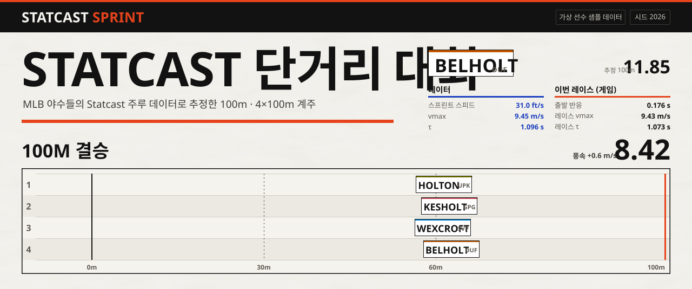
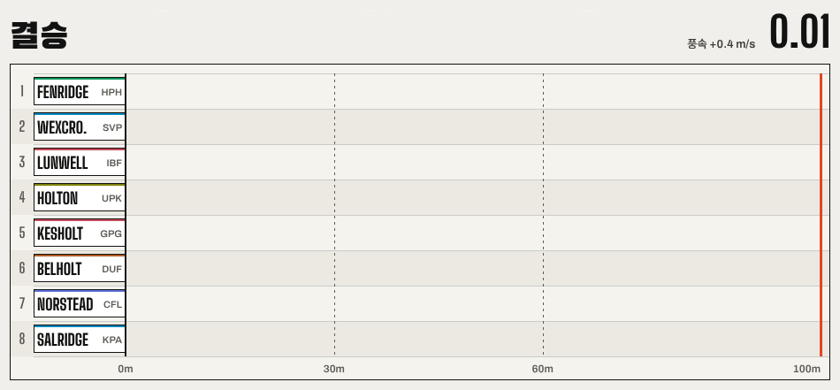
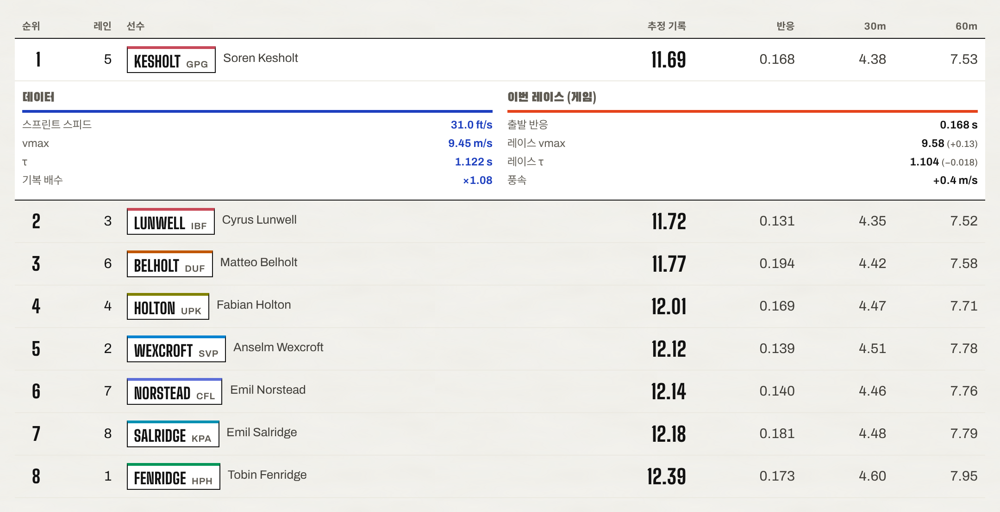
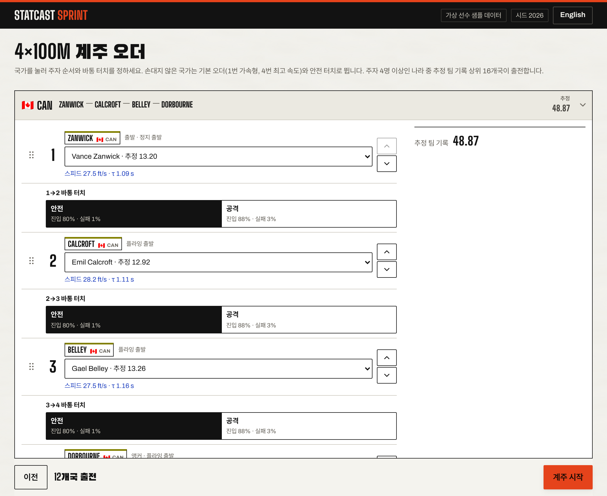
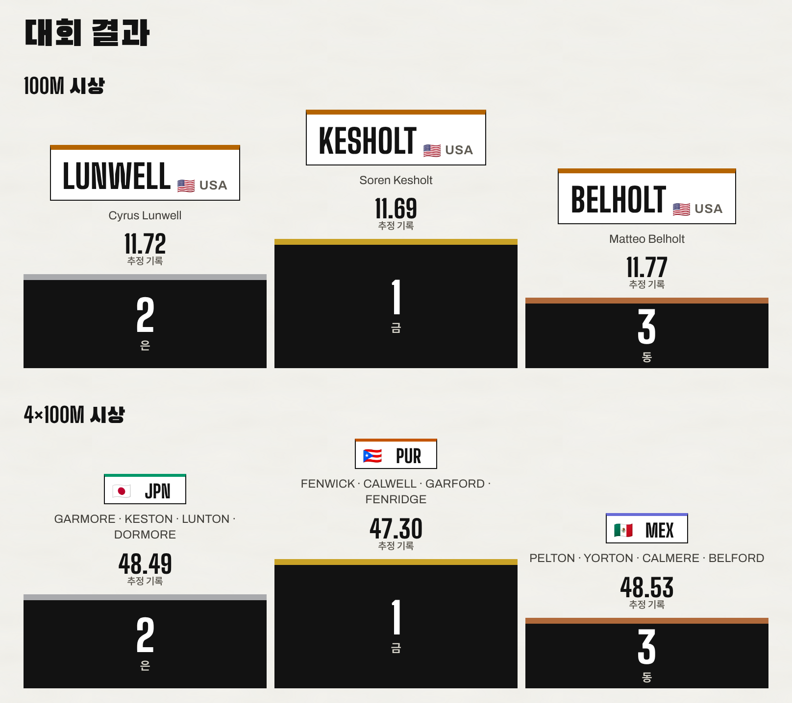
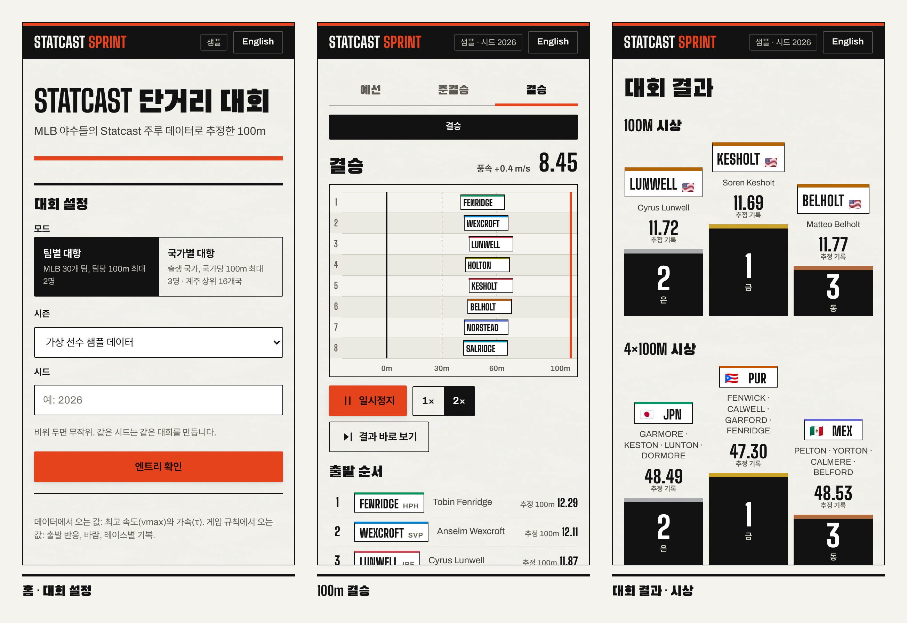

<a href="https://hpotty36.github.io/statcast-sprint/"></a>

<h1 align="center">Statcast 단거리 대회 <sub>statcast-sprint</sub></h1>

<p align="center">
  <a href="https://hpotty36.github.io/statcast-sprint/"></a>
</p>

<p align="center">
  <a href="https://github.com/HPotty36/statcast-sprint/actions/workflows/pages.yml"></a>
  
  
  
  
</p>

MLB 야수들의 Statcast 주루 데이터로 100m 기록을 **추정**하고, 그 선수들로 100m와 4×100m 계주 대회를 여는 브라우저 게임입니다. 팀별 대항(MLB 30개 팀)과 국가별 대항(출생 국가) 두 모드가 있고, 예선부터 결승까지 모든 조를 레이스 재생으로 볼 수 있습니다.

> **비공식 팬 프로젝트입니다.** MLB, MLB Advanced Media, Baseball Savant와 아무 관계가 없습니다. 저장소와 배포 페이지에는 **실제 선수 데이터가 없습니다.** 배포 페이지는 가상 선수 샘플로만 돌아가고, 실제 선수로 해 보려면 각자 아래 파이프라인으로 데이터를 받아 로컬에서 실행합니다.

*English: an unofficial fan project that estimates 100m times for MLB position players from Statcast baserunning data and runs a 100m and 4×100m relay meet in the browser. The repository and the [deployed page](https://hpotty36.github.io/statcast-sprint/) contain only fictional sample players; to use real players, fetch the data yourself with the local pipeline below.*



<p align="center"><sub>100m 결승 재생 (2배속, 시드 2026, 가상 선수). 엔진이 미리 계산한 궤적을 Canvas가 다시 그리기만 합니다.</sub></p>

## 기록은 어떻게 나오나

| 데이터에서 오는 값 | 게임 규칙에서 오는 값 |
|---|---|
| 최고 속도 `vmax` (Sprint Speed) | 출발 반응 시간, 부정출발 |
| 가속 시간 상수 `τ` (90ft 러닝 스플릿) | 바람, 레이스별 기복 |
| | 바통 터치 (안전 / 공격), 레인 배정 |

운동 모델은 아래 식을 풀어 100m 도달 시간을 구합니다 (`src/engine/kinematics.ts`, `pipeline/model.py`). 정지 출발은 `v0 = 0`, 계주의 플라잉 출발은 진입 속도 `v0 > 0` 입니다.

```math
d(t) = v_{max}\,t - (v_{max} - v_0)\,\tau\,\left(1 - e^{-t/\tau}\right)
```

- 화면과 CLI의 모든 기록은 **추정 기록**입니다. 실제 100m 기록이 아닙니다.
- 난수는 전부 시드 RNG에서 나옵니다. **같은 시드 + 같은 입력 = 같은 결과.**



<p align="center"><sub>결과 표의 줄을 열면 그 기록을 만든 값이 둘로 나뉩니다. <b>파란 괘선 아래는 Statcast 데이터</b>, 주황 괘선 아래는 이번 레이스의 게임 값입니다.</sub></p>

## 화면

<table>
  <tr>
    <td width="50%"></td>
    <td width="50%"></td>
  </tr>
  <tr>
    <td valign="top"><b>4×100m 계주 오더</b><br><sub>주자 순서와 구간별 바통 터치(안전 / 공격)를 고릅니다. 고친 오더는 공유 링크에 담깁니다.</sub></td>
    <td valign="top"><b>대회 결과</b><br><sub>국가별 대항(출생 국가). 시상대 블록은 잉크, 금·은·동은 6px 띠에만 씁니다.</sub></td>
  </tr>
</table>



<p align="center"><sub>휴대폰 세로 화면이 먼저입니다. 375px 폭에서도 가로 스크롤이 없습니다.</sub></p>

### 디자인: Race Bib

선수는 모두 **배번표**로 그립니다. 흰 Tyvek 태그에 검은 콘덴스드 성, 위쪽 3px 띠는 팀 코드에서 만든 색(`oklch(0.58 0.16 h)`, 실제 구단 색이 아님)입니다. 나머지는 배번을 찍은 종이: 섬유 결이 있는 바탕, 잉크 괘선, 그리고 뜻이 정해진 두 색.

| | 쓰는 곳 |
|---|---|
| **신호 주황** `#e5431b` | 주요 동작 버튼, 진행 중 탭, 상단 바 띠, 결승선, 구역을 여는 굵은 괘선 |
| **공식 파랑** `#1d3fbf` | 데이터에서 온 값만: 스프린트 스피드, vmax, τ, 30m·60m 통과 눈금 |
| 잉크 · 종이 | 그 밖의 전부. 진출(Q / q), 실격, 시청한 조 같은 상태는 색이 아니라 선 모양(실선 / 점선, 채움 / 외곽선, 취소선)으로 |

토큰·서체·컴포넌트 규칙은 [DESIGN.md](DESIGN.md) 에 있습니다. 위 그림들도 같은 토큰과 서체로 그렸습니다.

## 바로 해 보기

- 배포 페이지: [hpotty36.github.io/statcast-sprint](https://hpotty36.github.io/statcast-sprint/) (GitHub Pages, 가상 선수 샘플 데이터)
- 로컬:

```bash
npm install
```

```bash
npm run dev
```

`web/public/data/` 가 없으면 자동으로 가상 선수 샘플(`web/public/sample/players.sample.json`)을 씁니다.

### 공유 링크

대회를 시작하면 주소창이 그대로 공유 링크가 됩니다. 메달 테이블 화면의 **결과 공유**에서 복사할 수도 있습니다.

| 파라미터 | 뜻 |
|---|---|
| `mode` | `team` 또는 `nation` |
| `season` | 실데이터 시즌(예: `2026`) 또는 `sample` |
| `seed` | 대회 시드 (문자열) |
| `e` | 100m 엔트리 편집 `대표단:선수id.선수id;…` (있을 때만) |
| `r` | 계주 오더 편집 `대표단:주자id×4:바통(s=안전, a=공격)×3;…` (있을 때만) |

같은 링크를 다시 열면 같은 설정·시드·편집으로 같은 결과가 나옵니다. 링크로 열면 처음 화면에서 "메달 테이블 바로 보기"로 결과만 확인할 수도 있습니다. 실데이터 시즌 링크는 같은 데이터를 가진 사람에게만 같은 결과를 주고, 그 시즌 데이터가 없는 브라우저에서는 샘플로 열리며 그렇다고 알려 줍니다.

## 실데이터로 실행하기 (로컬 전용)

데이터는 Baseball Savant 리더보드 CSV와 MLB Stats API(선수 출생 국가)에서 받습니다. **받은 데이터는 `data/` 와 `web/public/data/` 에만 두고, 둘 다 gitignored 입니다. 커밋하지 마세요.**

Python 3.12 이상이 필요합니다 (Windows 기준 경로).

```bash
python -m venv .venv
```

```bash
.venv/Scripts/python -m pip install -r pipeline/requirements.txt
```

```bash
.venv/Scripts/python pipeline/fetch.py --season 2026
```

```bash
.venv/Scripts/python pipeline/people.py --season 2026
```

```bash
.venv/Scripts/python pipeline/params.py --season 2026
```

1. `fetch.py`: Savant CSV(Sprint Speed, 러닝 스플릿 등) → `data/raw/2026/`
2. `people.py`: MLB Stats API 선수 정보 → `data/raw/2026/people.json` (캐시)
3. `params.py`: `vmax`·`τ` 계산 → `data/players.2026.json` (+ `.meta.json` 처리 기록). 대표 국가를 바꿔야 하는 선수는 `pipeline/nation_overrides.csv` (`player_id,nation,note`)에 적습니다.

브라우저에서 쓰려면 결과를 `web/public/data/` 에 두고 시즌 목록을 만듭니다.

```text
web/public/data/players.2026.json
web/public/data/index.json        {"seasons": [2026]}
```

검증과 CLI:

```bash
.venv/Scripts/python pipeline/schema.py data/players.2026.json
```

```bash
npm run event -- --data data/players.2026.json --seed 2026 --mode nation
```

```bash
npm run calibrate -- --data data/players.2026.json
```

- `pipeline/notebooks/validate.ipynb` 는 출력 없이 커밋합니다 (출력에 실제 선수가 들어갑니다).
- Python 3.14 + Windows에서는 Jupyter 커널이 시작되지 않는 문제가 있어, 노트북은 3.12/3.13 가상환경에서 돌립니다.

## 개발

```bash
npm test
```

```bash
npm run lint
```

```bash
npm run typecheck
```

| 경로 | 내용 |
|---|---|
| `src/engine/` | 순수 TS 엔진 (운동 모델, 100m, 계주, 대회 진행, 메달). DOM·React 없이 Node에서 실행·테스트 |
| `src/engine/config.ts` | 모델 상수와 대회 규칙 숫자 (캘리브레이션 근거 주석 포함) |
| `src/ui/` | React 화면 |
| `pipeline/` | Python 데이터 파이프라인 (로컬 전용) |
| `scripts/` | CLI (`run-event.ts`, `calibrate.ts`, `check-dist.ts`) |
| `tests/` | Vitest |
| `docs/readme/` | 이 README의 그림 (배너·버튼·소셜 미리보기 SVG, 화면 캡처) |

README 그림을 다시 만들려면: 화면 캡처는 샘플 빌드를 띄운 뒤 `docs/readme/capture.mjs` (Playwright, 시드 2026), 배너·버튼 SVG는 글자를 고친 뒤 `docs/readme/embed_fonts.py` 로 그 글자만 담은 서체를 다시 넣습니다. 사용법은 두 파일 머리에 있습니다. 저장소 소셜 미리보기는 `docs/readme/social-preview.png` (1280×640)를 저장소 Settings → General → Social preview 에 올립니다.

전체 명세는 [PLAN.md](PLAN.md), 제품 맥락은 [PRODUCT.md](PRODUCT.md), 화면 디자인 규칙은 [DESIGN.md](DESIGN.md) 에 있습니다.

## 배포

`main` 에 push 하면 GitHub Actions(`.github/workflows/pages.yml`)가 lint·테스트 후 `VITE_DATA=sample` 로 빌드해 GitHub Pages에 올립니다. 저장소 설정의 Pages 소스는 **GitHub Actions** 로 둡니다.

빌드 결과물에 `data/` 경로 파일이 있거나 가상 선수가 아닌 선수 JSON이 있으면 `npm run check:dist` 가 실패해 배포가 멈춥니다. 로컬에서 같은 빌드를 확인하려면 (PowerShell):

```powershell
$env:VITE_DATA = 'sample'; npm run build; npm run check:dist
```

로컬에 `web/public/data/` 가 있으면 Vite가 그것까지 `dist/` 에 복사하므로 이 검사가 실패합니다. 의도된 동작입니다.

## 출처와 크레딧

- 데이터: [Baseball Savant](https://baseballsavant.mlb.com) (Statcast), MLB Stats API. 데이터의 권리는 각 제공자에게 있습니다.
- 국기 그래픽: [Twemoji](https://github.com/twitter/twemoji) (CC-BY 4.0), `country-flag-emoji-polyfill`
- 서체: Big Shoulders Display, Archivo, Black Han Sans (SIL OFL), Pretendard (SIL OFL). README 그림의 SVG에도 쓰인 글자만 골라 넣었습니다.
- README 배지: [Shields.io](https://shields.io)
